# PAST HARM

*for musicians · melody, harmony, rhythm, timbre, effects*

Nobody plays this piece. A set of rules, running on a sample clock, decides every note. The scores on this page are **transcriptions**: what the program actually played, logged note by note from the engine and written out. Each section explains a rule and shows it at work in real bars of the piece.

- [0 · Reading these scores](#0-reading-these-scores)
- [1 · Melody: a row that permutes](#1-melody-a-row-that-permutes)
- [2 · Harmony: keys, masks and snapping](#2-harmony-keys-masks-and-snapping)
- [3 · Rhythm: coprime streams](#3-rhythm-coprime-streams)
- [4 · Rhythm that mutates](#4-rhythm-that-mutates)
- [5 · Timbre](#5-timbre)
- [6 · Effects as instruments](#6-effects-as-instruments)
- [7 · Form](#7-form)

## 0. Reading these scores

**Pulse.** Everything sits on a grid of 8192 samples at 44.1 kHz, 0.186 s. Sixteen of these make a bar. Read the grid as sixteenth notes in 4/4 and the tempo is **♩ ≈ 80.7**. Bar numbers and clock times are marked above each system.

**Tuning.** past's note 0 is 140.06 Hz: 880 Hz × 2n/12, divided by 2π, because the 2003 code advances its phase in radians without the 2π. That is a C♯3 about **18 cents sharp**, and the whole piece is in equal temperament at that offset. Every note below is written at the nearest equal-tempered pitch: read "C♯" as C♯ +18 cents.

**Notation.** The scores are in **time-space notation**: a note's horizontal position is proportional to when it starts, and a line from the notehead shows how long it actually sounds (its envelope, including the release). There are no key signatures; an accidental holds to the end of its bar, as usual. Dynamics are shown as opacity.

- white: past's melody (three voices on one pitch)
- light blue: past's low figures
- teal: choir (past's long notes, sung)
- orange: solo choir voice
- rose: a note the harmony moved

## 1. Melody: a row that permutes

past composes from three short **rows**, nine semitone offsets each. The main row starts as `0 3 0 5 0 1 7 4 5`. A counter <i>n</i> steps through it. The melody plays row[<i>n</i>], an octave up, over and over on the sixteenth grid, and only moves on when the bass moves (each bass event advances <i>n</i>). The melody is therefore a **repeated-note pulse** whose pitch is set by the bass.

Meanwhile the rows are being shuffled. past has its own clock, the **tick**, and on it three permutations run: every 17 ticks two neighbouring notes of the main row swap; every 19 ticks a note is exchanged with the third row; every 23 ticks the second and third rows trade a note, transposed by `12 − row[j] mod 6`. 17, 19 and 23 are primes, so the three processes only line up again after 7,429 ticks. The row keeps its notes but changes its order, and the melody wanders through permutations of the same small set of pitches.

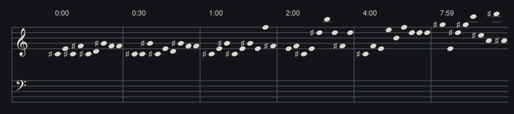

The main row (written as the melody plays it, an octave up) at six moments in the first eight minutes, taken from the engine's log. The pitches stay the same while their order drifts.

### Three voices on one pitch

The melody is three voices playing the same note, each placed differently against the grid:

| voice | where | when it plays | dynamics |
|---|---|---|---|
| A | on the sixteenth | first 20 s of each minute, in phrases of 26 ticks on, 13 off | swells and fades every ~18 s |
| B | 23 ms late (1/8 of a sixteenth): a flam | minutes 0–3 of each eight, phrases of 34 on, 17 off | softer, wavering every ~2 s |
| C | 23–46 ms late, the offset cycling through 17 positions with the tick | first 45 s of each minute | its own swell, every ~3 s |

B and C sit just behind A, like a player doubling a part slightly late. The gap between them changes from tick to tick, so the attack smears and sharpens. In the polyrhythm sections the short notes are also **accented** in groups of three sixteenths (3+3+3+3+4): notes off those accents are halved in level.

### The opening, as played

The first eight bars. The **mood** starts dark: past's melody is dropped an octave, the harmony is held to C♯ Phrygian, and a single choir voice sings a slow lament around the root, one note every two bars (root, ♭2, root, ♭7 below, root, ♭2, ♭6 below, root).

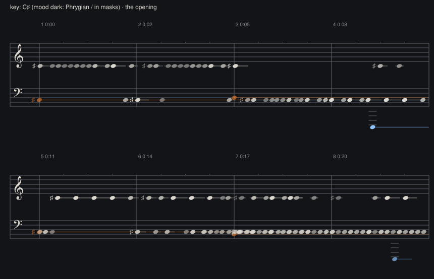

Bars 1–8 (0:00–0:24), as the engine played them. The orange notes are the solo lament; each lasts about 5½ s, swelling for ~1.4 s.

## 2. Harmony: keys, masks and snapping

past's rows don't belong to a key. They are interval sets, and with up to sixteen voices sounding, dense passages can pile up semitones and tritones. The piece keeps past's choices but moves each new note into the current key.

### Hearing the key

About every 12 ms the program counts which pitch classes are in the rows and sounding, weighted by loudness, and correlates that count with the Krumhansl–Kessler key profiles. These come from listening experiments and describe how strongly each scale degree belongs to a key. The best of the 24 major and minor keys wins, but only if it keeps winning for about four seconds, so the key moves the way a modulation does, not note by note. In the first eight minutes it settles mostly on C♯ minor and E major, with excursions to D minor, F minor, D♯ minor, A, B and G♯ major.

### Masks

Each new note moves to the nearest pitch of a **mask** on the key, rounding ties down. Which mask depends on how full the music is:

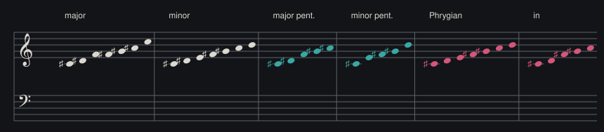

The masks, on C♯. With fewer than four voices sounding: the full major or natural minor scale. With four or more: only the pentatonic, which has no semitone or tritone between any two notes, so a dense chord cannot clash. During the dark opening: Phrygian, then the Japanese <i>in</i> scale (root, ♭2, 4, 5, ♭6).

### What past wrote, and what you hear

The same two bars, from a run with the harmony switched off (top) and on (bottom). The timing is identical; only the pitches move. Across the first eight minutes the harmony moves 1,157 of 3,134 notes. Nine in ten move by a semitone, usually down; the rest by a whole tone down.

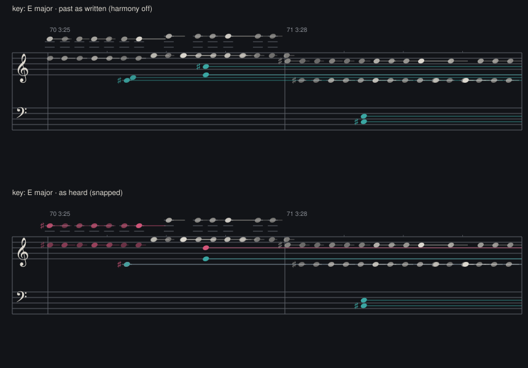

Bars 70–71 (3:25–3:31), key E major, many voices sounding, so the pentatonic mask is on. Top: past's own pitches. Bottom: as heard; the moved notes are in rose.

### The bass pairs and the choir

past's bass moves in **pairs**: row[<i>n</i>] and row[<i>n</i>+2] together, two octaves below the melody, on a 16-tick cycle at ticks 3, 7, 9 and 12. That gives the uneven rhythm 4 + 2 + 3 + 7. Each note has a six-second release, so pairs overlap into chords. From the first minute these long notes are given to a choir. They don't sound at once: each waits for the next beat of the bar's **three**, so the choir's chords land in half-note triplets against past's sixteenths.

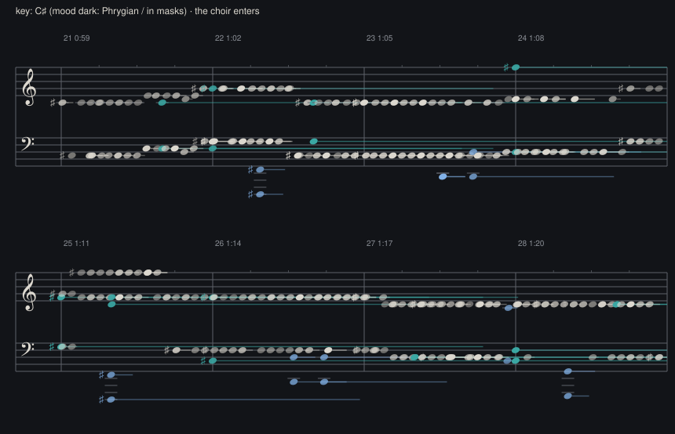

Bars 21–28 (0:59–1:22): the choir enters. Its chords (teal) arrive on the bar's three beats; past's melody and low figures carry on beneath.

## 3. Rhythm: coprime streams

Every rhythm in the piece divides the same bar. Two pulses that divide a bar into <i>a</i> and <i>b</i> beats meet every 1/gcd(<i>a</i>,<i>b</i>) of the bar. If <i>a</i> and <i>b</i> are **coprime** (no common factor) they meet only on the downbeat. Every other onset of one falls somewhere new against the other, and the ear hears two streams rather than one composite pattern. The piece runs several such streams together. Each musical stream has a **guide drum** doubling it: the drum plays at full level for four bars while the stream is new, then drops to a light doubling, and the music itself carries the rhythm.

| stream | per bar | in the music | guide drum, tuned to |
|---|---|---|---|
| choir | 3 | the choir's chords wait for these beats; the choir breathes on each | log drum, the fifth |
| past's accents | 3+3+3+3+4 sixteenths | accents on past's short notes | rim, the root |
| left echoes | 5 | harm's left delays sit on fifths of the bar | FM bell, chord tones |
| right echoes | 7 | harm's right delays on sevenths | tick, the ninth |
| harm's high tick | 11 against 8 | a tick in 11, heard only where it falls in the first 30% of an eighth-note | the fifth, high |
| harm's thump | 1 | every downbeat, the root, deep | — |

The drums come in with the arc of the piece, so the texture thickens one stream at a time: 3, then the rim, then the bell's 5, then the 7 near the top of each swell.

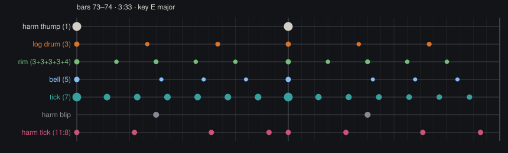

Bars 73–74 (3:34–3:40), all layers playing, from the engine's log; harm's thump, blip and tick are computed from its rules. Dot size is the level. Everything meets only at the bar line.

### past's other clock

past's **tick**, which moves the bass and shuffles the rows, does not run on the sixteenth grid at all. It starts at 26,384 samples, 3.22 sixteenths, and gets 30 samples shorter every minute. So the bass and its choir drift against the grid and the drums, a polytempo inside the piece. In the endless version this goes on for about ten hours, until the tick shrinks to exactly one sixteenth and locks to the grid.

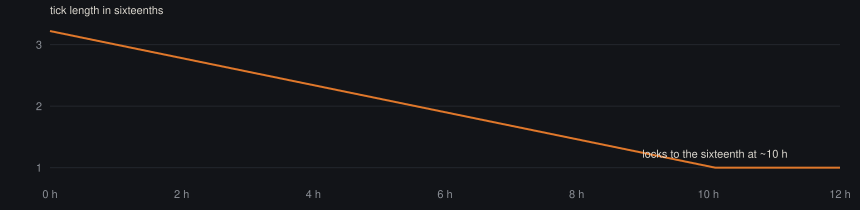

The length of past's tick, in sixteenths, over the first twelve hours.

### The minute as a form

past was written as an eight-minute piece, and its figures are switched on and off by the clock, giving each minute and each eight-minute section an internal shape:

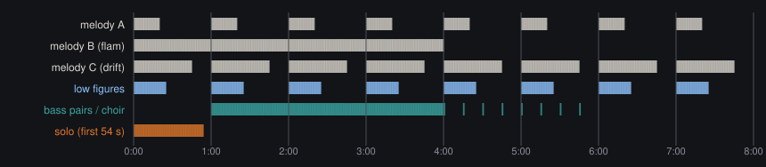

Which of past's figures play when, over one eight-minute section (the pattern repeats in the endless version).

## 4. Rhythm that mutates

In the endless version the divisions are not fixed. About every seven minutes (randomly six to eight), on a downbeat, one of them changes to a new value that is still coprime with the others. Possible values:

| stream | starts | can become |
|---|---|---|
| choir beat | 3 | 3, 4, 5, 7 |
| past's accents | groups of 3 | 3 (3+3+3+3+4), 5 (5+5+6), 7 (7+9) |
| left echoes | 5 | 3, 5, 7, 9, 11 |
| right echoes | 7 | 5, 7, 9, 11, 13 |
| harm's high tick | 11 | 9, 11, 13 |

When a stream changes, its guide drum comes back to full for four bars so the ear finds the new rhythm. When an echo grid changes, the delays slide to their new lengths over 10–40 s instead of jumping, like tape slowing, and the echoes bend in pitch by up to 17 cents on the way.

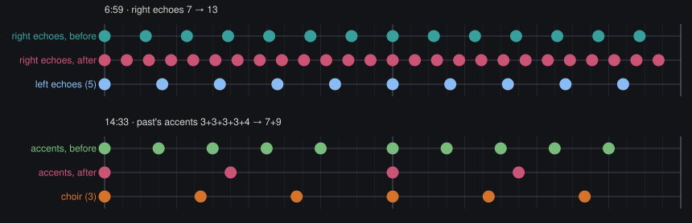

The first two mutations of the first hour: at 6:59 the right echoes go from 7 to 13 per bar; at 14:33 past's accents go from groups of 3 to 7 + 9.

## 5. Timbre

### past's voices

A past voice is not a single tone. Its odd partials run at a quarter of the note's frequency and its even partials at whole multiples, so every voice is a **harmonic series built two octaves below the written note**. It contains harmonics 1, 3, 5 and 7 of that low fundamental, then 8, 16 and 24, which are the written note and its octaves. The 5th and 7th harmonics are untempered: 14 and 31 cents flat of equal temperament. How many partials a voice has depends on which of the sixteen voice slots it is in (2 to 8), and they are weighted linearly down.

The odd partials also pass through an arctangent waveshaper whose drive is itself a slow sine (about 45 s). At low drive they are soft sines; at full drive the shaper squares them off and fills them with more odd harmonics. Every voice slowly breathes between pure and buzzy.

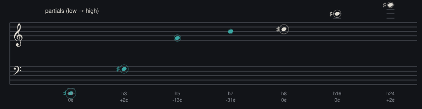

The spectrum of one past voice (slot 6, eight partials) playing C♯4. Teal: the waveshaped odd harmonics (1, 3, 5, 7 of a fundamental two octaves down). Ink: the plain even partials. Numbers are the harmonic number and its deviation in cents from the piece's equal temperament; ring size is the weight.

### The choir

The choir is built the way a real choir sounds: many voices, each slightly off pitch. Each harmonic of a sawtooth-like spectrum is spread into a band about 45 cents wide (wider for higher harmonics) with every frequency in the band at a random phase. Played back, this is a seamless ensemble that never beats regularly. The solo voice of the opening uses narrower bands, 12 cents, so it sounds like one singer. Three vowel formants drift between "ah" and "oh" with past's own slow cycles.

The choir's **richness** rises and falls over five minutes. At its thinnest the ensemble narrows towards mono. At its richest a second rank sings an octave up and a third a fifth up, like adding 4′ and 2⅔′ stops to an organ.

### The bass

Under the choir a sub-bass follows the lowest choir note, folded into 20–50 Hz: a pure fundamental plus three voices at −6, 0 and +6 cents, each with its 2nd and 3rd harmonics, so the low end beats slowly. Its weight swells over nine minutes, from a thin, dark sine to a driven, harmonically full bass.

### The drums are tuned

Every drum takes its pitch from the current key, so the percussion is part of the harmony. The bell moves through chord tones (third, fifth, octave, fifth, root), rotating with the four-bar phrase, and holds to the third and fifth until the piece is near its fullest.

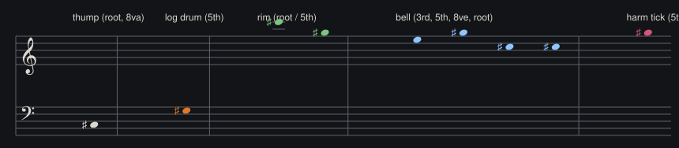

The pitched drums in C♯ minor (the deep thump is written an octave up). The high tick (the 9th, around 2.4–4.8 kHz) is off the staff.

## 6. Effects as instruments

### Echoes that play rhythms

harm's delay networks (2003) are kept, but their delay times are set to fractions of the bar. A note played on the downbeat comes back as a rhythm: fifths of the bar on the left, sevenths on the right. The echoes feed back into the networks, so they echo again, and the delay gains swell and fade on their own slow cycles. In effect the echoes are two more players, in 5 and in 7, improvising on whatever past plays.

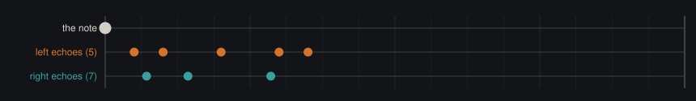

One note on the downbeat and its first echoes. Left (orange): ¼, ½, 1, 1½ and 1¾ fifths of a bar. Right (teal): ½, 1 and 2 sevenths. None lands on a sixteenth except the downbeat itself.

### A reverb that fills the silence

The reverb listens to how many notes are sounding. When past is busy the reverb is small, about 2 s and mostly dry. When the music thins it swells: up to 7.5 s and mostly wet, so the space fills in exactly where the notes leave it. The rests are never empty.

### The dark filter

During the opening the whole mix passes through a low-pass filter starting at 900 Hz, which opens fully over three minutes as the mood lifts.

## 7. Form

Several slow cycles shape the piece, none of them in step with the others:

| cycle | period | what it shapes |
|---|---|---|
| the arc of voices | 150 s, its height varying over 330 s | how many voices may sound at once (2 to 16), and which drums play |
| the mood | once, 0:20 to 3:20 | from dark (Phrygian, low, filtered, solo lament) to open |
| past's sections | 8 min | which figures play (above) |
| choir richness | 5 min | ensemble width, extra ranks |
| bass weight | 9 min | the sub-bass, thin to full |
| rhythm mutation | ~7 min, random | one coprime division changes |
| past's tick | shortens for ~10 h | the bass's tempo against the grid |

Five- and nine-minute cycles line up only every 45 minutes; with the eight-minute sections, every six hours. The random mutations mean that even then the music is in a different state. The piece is deterministic, the same every time from the start, but it never repeats.

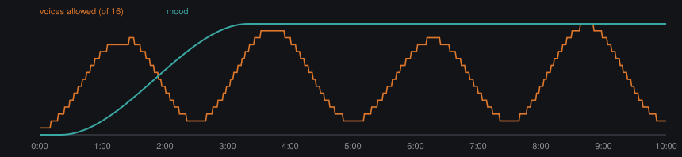

The first ten minutes: how many voices may sound (orange) and the mood (teal).

past's rows, voices, timing and minute form are Joshua Reich's 2003 code; harm's delay networks and drums are his 2003 code; the harmony (key finding, masks), choir, bass, guide drums, mutations, reverb and the re-timing of harm were added in 2026, with Claude. The scores are generated from the engine itself (`tools/musiclog`, `tools/mkmusicians.py`). For the mathematics and code, see the [technical statement](TECHNICAL_STATEMENT.md).
