# PAST HARM

*Joshua Reich · Generative Works 1996–2026 · technical statement*

Three programs, written years apart, run as one piece. **past** (written before 2003; the surviving files are copies made in 2003) is a generative music engine: sixteen oscillators, a few scales and a nest of slow sine waves. **harm** (also before 2003, rendered 2006) is a set of feedback delay networks with drums. **p10m1** (March 2012) is a feedback picture of rotating cubes. Here past plays, harm listens to it, and the picture reads past's internal state. This page walks through the ideas and the mathematics, starting with the music, with the code quoted directly from the source. The 2026 version was made with Claude, and each section says which parts are original and which were added ([section 16](#16-who-made-what)).

- [1 · Signal flow](#1-signal-flow)
- [2 · How a voice is made](#2-how-a-voice-is-made)
- [3 · The cross-coupled filter](#3-the-cross-coupled-filter)
- [4 · Scales, keys and harmony](#4-scales-keys-and-harmony)
- [5 · The arc and the mood](#5-the-arc-and-the-mood)
- [6 · The choir: PADsynth](#6-the-choir-padsynth)
- [7 · The bass](#7-the-bass)
- [8 · Coprime polyrhythms](#8-coprime-polyrhythms)
- [9 · Rhythm that mutates](#9-rhythm-that-mutates)
- [10 · harm's delay networks](#10-harms-delay-networks)
- [11 · A reverb that fills the gaps](#11-a-reverb-that-fills-the-gaps)
- [12 · Long swells and endlessness](#12-long-swells-and-endlessness)
- [13 · The picture](#13-the-picture)
- [14 · Glass](#14-glass)
- [15 · A title that gets eaten](#15-a-title-that-gets-eaten)
- [16 · Who made what](#16-who-made-what)

> Each section below starts with a note on where its parts came from, using three labels:<br>
>  **`original`** Joshua Reich's pre-2003 / 2012 code, kept.<br>
>  **`directed`** Added in 2026 at his direction. The idea, and often the technique, are his; the implementation is Claude's.<br>
>  **`Claude`** Added in 2026, where the specific choice was made by Claude (Anthropic's AI model) and then accepted or adjusted by him.<br>
>  [Section 16](#16-who-made-what) gives the numbers.

## 1. Signal flow

> **`directed`** Combining past, harm and p10m1 into one piece, with the picture reading the music's state, was Joshua's idea. **`Claude`** The wiring is Claude's: the struct port of past, audio output, snapshots for the picture, and the offline renderer.

All the sound comes from one function, `past_next()`, called 44,100 times a second. Its sample index <i>i</i> is the only clock: every slow change in the piece is a function of <i>i</i>, so the piece is deterministic. Rendered twice, it is identical to the sample. The picture runs at its own frame rate and reads snapshots of the engine's state: which voices sound, their notes and envelopes, the key, the drum hits, the echo gains.

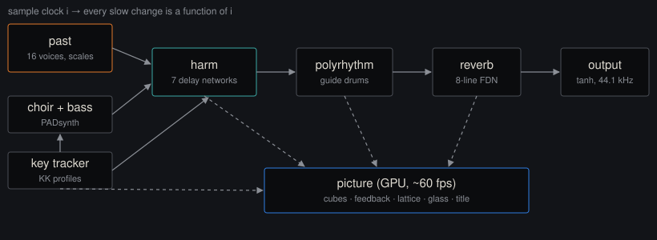

<sub>Audio flows left to right, once per sample. The dashed lines are state the picture reads, about 60 times a second.</sub>

## 2. How a voice is made

> **`original`** past (pre-2003), kept verbatim. The code below is Joshua's. past alone still renders byte-identical to the original program.

past has sixteen oscillators. A note sets an oscillator's phase increment from its frequency and gives it an attack / hold / release envelope. What a voice sounds like depends on its slot <i>j</i>: it sums <i>N</i> = 2 + (<i>j</i> mod 7) partials, weighted linearly down from the fundamental:

> <i>w<sub>k</sub></i> = (<i>N</i> − <i>k</i>) / (<i>N</i>(<i>N</i>−1)/2), <i>k</i> = 0 … <i>N</i>−1 (Σ<i>w<sub>k</sub></i> = 1)

Even partials are plain sines at <i>k</i> times the phase. Odd partials go a quarter as fast, at <i>k</i>/4 times the phase, through an <i>arctangent waveshaper</i> whose drive is itself a sine of period 2π·319732 samples, about 45 s:

> odd <i>k</i>: <i>w<sub>k</sub></i> · atan( sin(<i>kφ</i>/4) · 7 sin(<i>i</i>/319732) )

When the drive is near zero the partial is a soft sine; at full drive the arctangent squares it off and fills it with odd harmonics. The drive passes through zero twice a cycle, so every voice slowly breathes between pure and buzzing. Odd and even slots are routed to different accumulators (<i>x, y</i> and <i>u, v</i>), which become left and right.

`past_engine.c:892`

```c
num = 2 + (j % 7);
sum = num * (num-1) * 0.5;
for (k = 0; k < num; k++)
if (k % 2 == 1)
{
    if  (j % 2 == 1)
    {
        s->u += ((num-k) / sum) * amp *
            (
            atan(
                sin(o->phase*k*0.25*(j%2 + 1)) *
                sin(i / 319732.0) * 7.0
                )
            ) ;
    } else
    {
        s->v += ((num-k) / sum) * amp *
            (
            atan(
                sin(o->phase*0.25*k*(j%2 + 1)) *
                cos(i / 384972.0) * 7.0
                )
            ) ;
    }
} else
{
    if  (j % 2 == 1)
    {
        s->x += ((num-k) / sum) * amp *
            (
                sin(o->phase*k*(j%2 + 1))
            ) ;
    } else
    {
        s->y += ((num-k) / sum) * amp *
            (
                sin(o->phase*k*(j%2 + 1))
            ) ;
    }
}
```

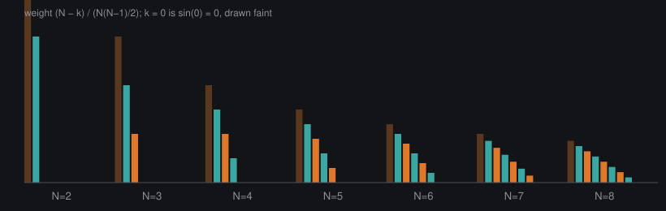

<sub>Partial weights for each of the seven voice types (N = 2 … 8). Orange: plain sines (even k). Teal: arctangent-shaped partials (odd k).</sub>

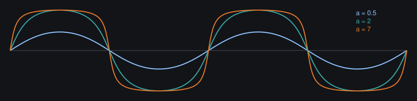

<sub>atan(sin θ · <i>a</i>) for drive <i>a</i> = 0.5, 2, 7. The drive itself is a slow sine, so the timbre rounds and squares over ~45 s.</sub>

## 3. The cross-coupled filter

> **`original`** past (pre-2003), verbatim. **`Claude`** The picture reading these coefficients is a 2026 mapping.

Before the output, the two channels are fed back into each other through the previous three samples. The coefficients are sines with long, unrelated periods, about 10 s, 30 s, 34 s and 2 min, some offset by the current tick. Together they form a time-varying second-order recursive filter in which left drives right and right drives left:

`past_engine.c:940`

```c
s->y =  s->y + 0.30*sin(i / 441000.0)*s->oy1 - (0.75*sin(i/894712.0 + s->tick) + 0.23 )*
                (0.3*sin(i/20127.0 + s->tick%7)*s->ox2 - 0.47*sin(i/33391.0)*s->ox3);
s->x =  s->x+ 0.30*sin(i / 441000.0)*s->ox1 - (0.75*sin(i/749732.0 + s->tick) + 0.26)*
                (0.3*sin(i/42129.0 + s->tick%3)*s->oy2 - 0.53*sin(i/33385.0)*s->oy3);

s->outl += 32768 * (atan((s->x+s->v) / (float)s->num_on) / 1.6 );
s->outr += 32768 * (atan((s->y+s->u) / (float)s->num_on) / 1.6 );
```

Because the periods share no common factor, the filter never repeats its settings. The colour and stereo image of the whole texture drift endlessly, even while the notes repeat. The output then goes through `atan(·)/1.6`, a soft clipper, so the feedback can never run away. The picture uses these same coefficients: the background's radial warp, the blur and the feedback decay all read them.

## 4. Scales, keys and harmony

> **`original`** The scale tables are past's. **`directed`** Making full passages more harmonious, and a sparse, oppressive opening, were Joshua's requests. **`Claude`** The method is Claude's: key finding by Krumhansl–Kessler correlation, snapping to the scale, pentatonic once four voices sound, and the Phrygian and <i>in</i> scales for the opening. In the full piece this code moves some of past's notes: the engine is unmodified, but in dense passages the pitches heard are snapped to a scale past did not choose.

past's melody comes from short scale tables: offsets in semitones such as `{0, 3, 0, 5, 0, 1, 7, 4, 5}`, stepped through by a counter. Notes can collide: with up to sixteen voices and three tables, a full passage can stack semitones and tritones. Three additions keep the harmony consonant without changing past's choices.

### Finding the key

Every 512 samples a 12-bin **pitch-class histogram** is built from the scale tables and the sounding voices, weighted by their envelopes. It is correlated (Pearson's r) against the Krumhansl–Kessler probe-tone profiles, rotated to all 12 tonics in major and minor; the best of the 24 is the key. A change of key has to win for about 4 s, or by a clear margin, so the key doesn't flicker.

> <i>r</i>(<i>h</i>, <i>p</i>) = Σ(<i>h<sub>i</sub></i>−<i>h̄</i>)(<i>p<sub>i</sub></i>−<i>p̄</i>) / √( Σ(<i>h<sub>i</sub></i>−<i>h̄</i>)² · Σ(<i>p<sub>i</sub></i>−<i>p̄</i>)² )

`key.c:32`

```c
for (m = 0; m < 2; m++)
    for (kk = 0; kk < 12; kk++)
    {
        float c;
        for (i = 0; i < 12; i++) prof[(i + kk) % 12] = (m ? kk_min : kk_maj)[i];
        c = corr (h, prof);
        if (c > best) { best = c; pc = kk; minor = m; }
    }
```

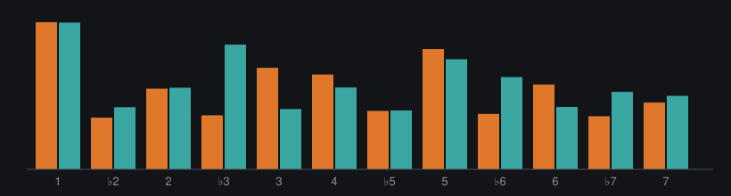

<sub>The Krumhansl–Kessler profiles (major in orange, minor in teal): how well each pitch class fits a key, from listening experiments. The tonic, fifth and third stand out.</sub>

### Snapping to the key

Each new note moves to the nearest pitch in a mask of the key's 12 pitch classes, rounding ties down. Which mask depends on how full the music is. With fewer than four voices, the full seven-note scale is allowed. With four or more, only the **pentatonic**, the five notes with no semitone or tritone between any two of them, so a dense chord cannot clash. During the opening, while the mood is dark, the masks are **Phrygian**, minor with a flat second, and then the Japanese **in** scale (root, ♭2, 4, 5, ♭6), which is darker still.

`past_engine.c:53`

```c
static int snap_note (const past_state *s, int note)
{
    static const char dia[2][12] = { { 1,0,1,0,1,1,0,1,0,1,0,1 }, { 1,0,1,1,0,1,0,1,1,0,1,0 } };
    static const char pen[2][12] = { { 1,0,1,0,1,0,0,1,0,1,0,0 }, { 1,0,0,1,0,1,0,1,0,0,1,0 } };
    int n = 0, o, d;
    const char *ok;
    for (o = 0; o < PAST_OSCS; o++) if (s->osc[o].is_on && !s->osc[o].solo && s->osc[o].env > 0.1f) n++;
    ok = n >= 4 ? pen[s->key_minor ? 1 : 0] : dia[s->key_minor ? 1 : 0];
    /* the oppressive opening: Phrygian (minor with a flat 2nd), and once 4 or
       more voices sound the in scale (root, b2, 4, 5, b6) -- until the mood
       is half way open */
    if (s->mood < 0.5f)
    {
        static const char phr[12] = { 1,1,0,1,0,1,0,1,1,0,1,0 };
        static const char ins[12] = { 1,1,0,0,0,1,0,1,1,0,0,0 };
        ok = n >= 4 ? ins : phr;
    }
    for (d = 0; d <= 6; d++)
    {
        if (ok[(((note - d - s->key_pc) % 12) + 12) % 12]) return note - d;
        if (ok[(((note + d - s->key_pc) % 12) + 12) % 12]) return note + d;
    }
    return note;
}
```

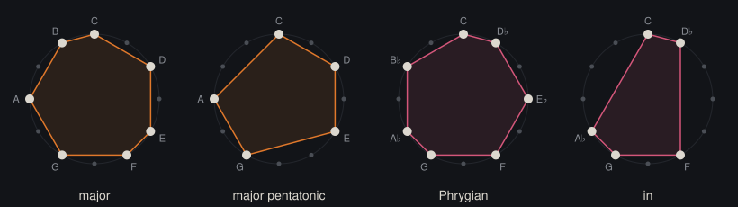

<sub>The four masks on the chromatic circle, in C. The lines join the allowed pitch classes. The pentatonic has no adjacent pair, which is the property that removes semitone clashes.</sub>

## 5. The arc and the mood

> **`directed`** Starting sparse, building up and down, and an oppressive opening that opens out, and the mood's 13-minute cycle, were Joshua's. **`Claude`** The curves (150 s × 330 s, the 0:20–3:20 smoothstep), the octave drop, the lament and the darkening low-pass are Claude's.

How many voices may sound at once follows a raised cosine of period 150 s. Its height is modulated by a second raised cosine of period 330 s, so no two swells are the same size. The cap runs from 2 to 16 voices, so the piece opens sparse, builds, and thins out again, and the drums, the choir and the bell come in as it rises.

> <i>w</i>(<i>t</i>) = ½(1 − cos 2π<i>t</i>/150) · (0.8 + 0.2·½(1 − cos 2π<i>t</i>/330)), cap = 2 + round(14<i>w</i>)

`past_engine.c:37`

```c
static int voice_cap (const past_state *s)
{
    double t = s->i / 44100.0;
    double w = 0.5 - 0.5 * cos (2.0 * PI * t / 150.0);
    w *= 0.8 + 0.2 * (0.5 - 0.5 * cos (2.0 * PI * t / 330.0));
    {
        int cap = 2 + (int) lround (14.0 * w);
        if (s->mood < 0.3f && cap > 1) cap--;        /* the opening: sparser still */
        return cap;
    }
}
```

Over that, the **mood** rises as a smoothstep from 0 to 1 between 0:20 and 3:20. In the endless piece it then cycles every 13 minutes: it stays open until about 10:50, closes over the next two minutes, stays dark for about 30 s, and opens again the way the piece began, so the first eight minutes are unchanged. While it is low, the notes drop an octave, the harmony uses the dark masks, a single choir voice sings a lament around the root, and the whole mix passes through a low-pass filter that starts at 900 Hz and opens (cutoff 900·2<sup>4.5·mood</sup> Hz). The piece begins sparse and oppressive and opens out.

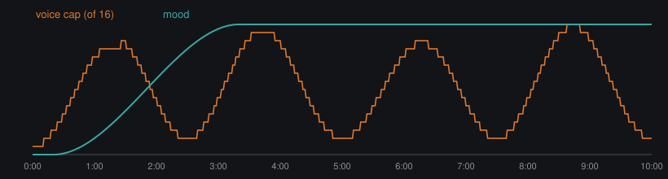

<sub>The first ten minutes: the voice cap (orange steps) and the mood (teal).</sub>

## 6. The choir: PADsynth

> **`directed`** The choir, a single solo voice at the start, and the technique (Gaussian bands in the frequency domain, random phases, a saw's overtone series) were Joshua's. **`Claude`** The implementation, the bandwidths (45 and 12 cents), the tables per octave and the vowel formants are Claude's.

past's long notes, the bass pairs, are sung by a choir. A choir is many voices that are almost, but not quite, in tune. Rather than detune a few oscillators, the choir is built in the **frequency domain**, after Nasca Octavian Paul's PADsynth. For a base pitch <i>f</i><sub>0</sub>, each harmonic <i>h</i> becomes a Gaussian band whose width grows with <i>h</i>, at saw-wave amplitudes 1/<i>h</i>:

> |<i>X</i>(<i>f</i>)| = Σ<sub><i>h</i></sub> (1/<i>h</i>) · exp(−((<i>f</i> − <i>hf</i><sub>0</sub>)/<i>b<sub>h</sub></i>)²) / √<i>b<sub>h</sub></i>, <i>b<sub>h</sub></i> = (2<sup>c/1200</sup> − 1) · <i>f</i><sub>0</sub> · <i>h</i>

Each frequency bin then gets a **random phase**, and one inverse FFT of 2<sup>18</sup> points turns the whole spectrum into a 5.9-second loop. Because every bin has its own random phase, the loop sounds like many singers each slightly off pitch, and it is perfectly seamless. The ensemble is 45 cents wide; the solo voice of the opening is 12 cents wide (narrower, so it sounds like one person). One table is built for each octave of base pitch, then read at the note's pitch through three vowel formants that drift between "ah" and "oh".

`past_engine.c:194`

```c
for (h = 1; h * f0 < 10000.0; h++)
{
    double fh = h * f0, bw = (pow (2.0, bw_cents / 1200.0) - 1.0) * f0 * pow (h, bw_scale);
    double c = fh * PAD_N / 44100.0, w = bw * PAD_N / 44100.0;    /* in bins */
    int lo = (int) (c - 4 * w) - 1, hi = (int) (c + 4 * w) + 1;
    if (w < 0.5) w = 0.5;
    for (k = lo < 1 ? 1 : lo; k <= hi && k < PAD_N / 2; k++)
    {
        double x = (k - c) / w;
        mag[k] += (1.0 / h) * exp (-x * x) / sqrt (w);    /* equal energy per harmonic */
    }
}
for (k = 1; k < PAD_N / 2; k++)
{
    double ph;
    seed = seed * 1664525u + 1013904223u;
    ph = 2.0 * M_PI * (seed >> 8) / 16777216.0;
    re[k] = mag[k] * cos (ph); im[k] = mag[k] * sin (ph);
    re[PAD_N - k] = re[k]; im[PAD_N - k] = -im[k];        /* real output */
}
fft_inverse (re, im, PAD_N);
```

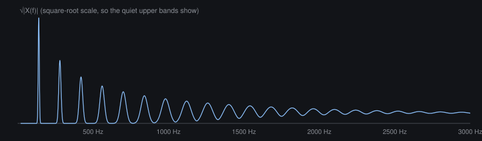

<sub>The spectrum of one table (140 Hz, 45 cents). Each harmonic is a Gaussian whose width grows with its number, so the upper harmonics smear into a shimmer while the lower ones stay pitched.</sub>

## 7. The bass

> **`directed`** A heavy, solid bass, then thicker, an octave lower, then leaner, were Joshua's calls. **`Claude`** The design (pure fundamental, detuned voices, tanh, low-pass) and its constants are Claude's.

Under the choir sits a sub-bass that follows its lowest note, folded by octaves into 20–50 Hz. It is a pure fundamental, for weight, plus three voices detuned by −6, 0 and +6 cents. Each detuned voice carries its 2nd and 3rd harmonics, and because they beat slowly against each other the body moves. It all goes through a tanh saturator and a low-pass filter. Its weight, the level, the amount of harmonic body, the drive and the cutoff, rides one of the long swells (section 12).

`past_engine.c:282`

```c
static const double det[3] = { 0.99654, 1.0, 1.00347 };
double body = 0;
int v;
s->bass_ph += 2.0 * PI * s->bass_f / 44100.0;
if (s->bass_ph > 2.0 * PI) s->bass_ph -= 2.0 * PI;
for (v = 0; v < 3; v++)
{
    double ph;
    s->bass_ph3[v] += 2.0 * PI * s->bass_f * det[v] / 44100.0;
    if (s->bass_ph3[v] > 2.0 * PI) s->bass_ph3[v] -= 2.0 * PI;
    ph = s->bass_ph3[v];
    body += sin (ph) + 0.5 * sin (2.0 * ph) + 0.28 * sin (3.0 * ph);
}
/* the bass's weight (bass_rich, 0..1; 0.5 = as it was): the
   harmonic body, the drive and the low-pass open up with it, and
   its level swells from about a third to 1.35x */
{
    float br = s->bass_rich, drive = 0.9f + 0.8f * br;
    y = (float) (1.0 * sin (s->bass_ph) + (0.05 + 0.4 * br) * body / 3.0);    /* leaner: it masked past's chords */
    y = tanhf (drive * y) / tanhf (drive);
    s->bass_lp += (y - s->bass_lp) * (float) (1.0 - exp (-2.0 * PI * (150.0 + 140.0 * br) / 44100.0));
```

## 8. Coprime polyrhythms

> **`directed`** Meaningful polyrhythms in past, harm and the choir, drums that guide the listener toward them, and using harm's own drum sounds, were Joshua's. **`original`** The thump, tick, blip and sweep are harm's pre-2003 clicks, re-timed. **`Claude`** The divisions (3, 3+3+3+3+4, 5, 7, 11:8), pairing each stream with a drum that plays at full then drops to 40%, and the drum timbres (log drum, rim, FM bell, tick) are Claude's.

past ticks on a grid of 8192 samples, 0.186 s. Sixteen ticks make a **bar** of 131,072 samples, 2.97 s, and every rhythm in the piece is a division of that bar. Two pulses dividing the same bar into <i>a</i> and <i>b</i> beats coincide at fractions <i>m</i>/<i>a</i> = <i>n</i>/<i>b</i>, that is, every 1/gcd(<i>a</i>, <i>b</i>) of a bar. If <i>a</i> and <i>b</i> are **coprime** (gcd = 1), they meet **only on the downbeat**. Between downbeats every onset of one falls in a different place against the other, and the gaps between successive onsets of the combined pattern are all different. That is what lets the ear hear two streams instead of one.

> onsets of <i>a</i> ∩ onsets of <i>b</i> = { <i>k</i> / gcd(<i>a</i>,<i>b</i>) } ⇒ gcd = 1: only the downbeat

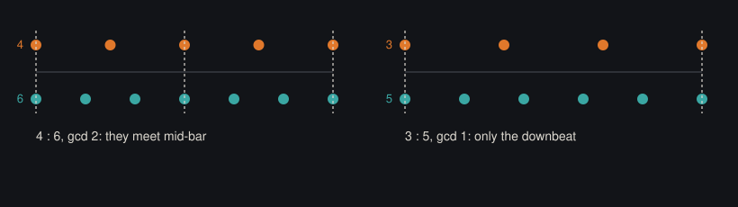

<sub>Left: 4 against 6 (gcd 2) meet mid-bar, and the pattern collapses into a simpler one. Right: 3 against 5 (gcd 1) meet only on the downbeat, and the combined onsets are all at different distances.</sub>

The piece runs five streams at once. Each musical stream, a voice that is part of the music itself, is paired with a **guide drum** that plays its pulse. When a stream is new to the ear, its drum plays at full level for four bars, then drops to 40% as a light doubling, and the music carries the rhythm on its own:

| stream | division | in the music | guide drum |
|---|---|---|---|
| choir beat | 3 | the choir's notes wait for the next beat in 3, and it breathes on each | log drum on the fifth |
| past's accents | 3 + 3 + 3 + 3 + 4 | past's own short notes are accented in groups of 3 of its 16 steps: 3 against 4 inside its own grid | rim |
| left echoes | 5 | harm's left delay network has taps on fifths of the bar | FM bell on the third |
| right echoes | 7 | harm's right delay network has taps on sevenths of the bar | tick on the ninth |
| harm's high tick | 11 : 8 | harm's click re-timed: a tick in 11 gated by a pulse in 8 | — |

`past_engine.c:329`

```c
/* which hit of its bar layer k is on at bar position b */
static int poly_index (const past_state *s, int k, unsigned long b)
{
    if (k == 2)        /* the rim: every g steps (3: steps 0, 3, 6, 9, 12), the last group takes the rest */
    {
        int g = s->gene[1], st = (int) (b / 8192) / g, last = (16 - g) / g;
        return st > last ? last : st;
    }
    return (int) ((b * (unsigned long) poly_div (s, k)) / PAST_BAR);
}
```

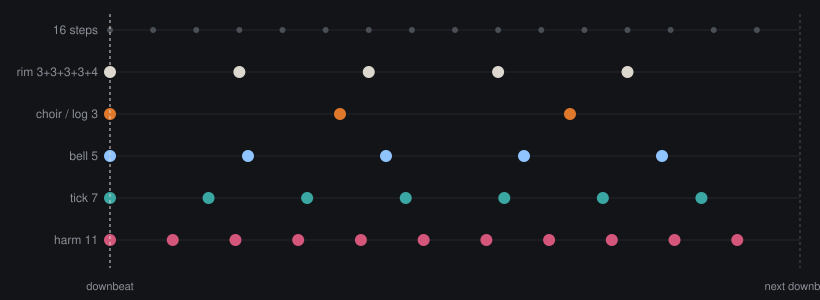

<sub>One bar: past's 16 steps, the rim's 3+3+3+3+4, and the pulses in 3, 5, 7 and 11. They all meet only at the downbeat. Every drum takes its pitch from the current key (root, fifth, third, ninth), so the rhythm stays in the harmony.</sub>

## 9. Rhythm that mutates

> **`directed`** The design is Joshua's: new coprime seeds, delay times that change, mutations staggered, one random change about every 7 minutes. **`Claude`** The value pools, the coprimality rule, the guide drum's return and the 1% tape-style glide are Claude's.

In endless mode the five divisions are **genes**. About every seven minutes (randomly 6–8, always on a downbeat), one gene is picked at random and given a new value from its pool. The new value must be coprime with the other beats (the accent grouping is exempt), so the streams can never lock together. The changed stream's guide drum comes back to full for four bars, pointing the ear at the new rhythm.

`past_engine.c:343`

```c
static int gcd_i (int a, int b) { while (b) { int t = a % b; a = b; b = t; } return a; }
static unsigned int mut_rand (past_state *s)
{
    s->mut_rng = s->mut_rng * 1664525u + 1013904223u;
    return s->mut_rng >> 8;
}
static void mutate (past_state *s)
{
    static const int pool[5][6] = { {3, 4, 5, 7, 0}, {3, 5, 7, 0}, {3, 5, 7, 9, 11, 0}, {5, 7, 9, 11, 13, 0}, {9, 11, 13, 0} };
    int tries, g0 = (int) (mut_rand (s) % 5);
    for (tries = 0; tries < 5; tries++)
    {
        int g = (g0 + tries) % 5, cand[6], n = 0, c, o;
        for (c = 0; pool[g][c]; c++)
        {
            int v = pool[g][c], ok = v != s->gene[g];
            if (g != 1)
                for (o = 0; o < 5 && ok; o++)
                    if (o != g && o != 1 && gcd_i (v, s->gene[o]) != 1) ok = 0;
            if (ok) cand[n++] = v;
        }
        if (n)
        {
            s->gene[g] = cand[mut_rand (s) % (unsigned) n];
            s->mut_gene = g;
            s->mut_count++;
            /* its drum guides the ear to the new rhythm again */
            if (g < 4) s->poly_bars[g + 1] = 0;
            if (s->verbose) printf ("mutation %d at bar %d: gene %d -> %d\n", s->mut_count, s->bar, g, s->gene[g]);
            return;
        }
    }
}
```

When a delay grid mutates, harm's taps do not jump to their new lengths, which would click. They **glide** at most 0.01 samples per sample, reading between samples with linear interpolation:

> <i>y</i> = <i>d</i>[⌊τ⌋] + (τ − ⌊τ⌋)(<i>d</i>[⌊τ⌋+1] − <i>d</i>[⌊τ⌋]), |dτ/d<i>t</i>| ≤ 0.01 ⇒ pitch ratio 1 ± 0.01 (≈ 17 cents)

A delay line whose length changes shifts the pitch of what passes through it (the tape-delay effect): its echoes bend by at most 17 cents for the 10–40 s that the change takes, then settle on the new grid.

`harm_fx.c:338`

```c
/* (added) past's networks: when a delay grid mutates, the taps glide
   to their new lengths (at most 1% a sample, 17 cents: a tape-like bend of the
   echoes, not a jump), read between samples on the way */
if (j == 2 || j == 3)
{
    double *p = &h->tp[j][n], tg = (double) buf->tap[n].tapnum;
    if (*p <= 0) *p = tg;
    else if (*p != tg) *p = fabs (tg - *p) <= 0.01 ? tg : *p + (tg > *p ? 0.01 : -0.01);
}
if ((j == 2 || j == 3) && h->tp[j][n] != (double) buf->tap[n].tapnum)
{
    unsigned int ip = (unsigned int) h->tp[j][n];
    float fr = (float) (h->tp[j][n] - ip);
    float d0 = buf->data[(buf->idx - ip) % CBUF_SIZE], d1 = buf->data[(buf->idx - (ip + 1)) % CBUF_SIZE];
    d = d0 + fr * (d1 - d0);
}
else d = buf->data[(buf->idx - buf->tap[n].tapnum) % CBUF_SIZE];
```

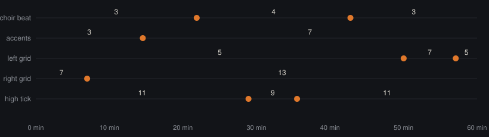

<sub>The first hour of mutations (simulated): one gene at a time, at staggered intervals.</sub>

## 10. harm's delay networks

> **`original`** harm (pre-2003): `convolve()`, the networks and their moving gains, verbatim. **`Claude`** Putting the taps on fractions of past's bar, the stability scaling and the de-clicking glides are Claude's.

harm is a bank of seven feedback delay networks. Each is a single circular buffer, 50,000 samples long, read at up to six taps. The taps feed forward to the output with gains <i>g</i><sup>f</sup> and back into the buffer with gains <i>g</i><sup>b</sup>. In z-transform terms each network is an all-pole comb filter with a direct path:

> <i>s</i>[<i>n</i>] = <i>x</i>[<i>n</i>] + Σ<sub><i>k</i></sub> <i>g<sup>b</sup><sub>k</sub></i> <i>s</i>[<i>n</i> − τ<sub><i>k</i></sub>], <i>y</i>[<i>n</i>] = <i>g</i><sub>0</sub><i>x</i>[<i>n</i>] + Σ<sub><i>k</i></sub> (<i>g<sup>f</sup><sub>k</sub></i> + <i>g<sup>b</sup><sub>k</sub></i>) <i>s</i>[<i>n</i> − τ<sub><i>k</i></sub>], <i>H</i>(<i>z</i>) ∝ 1 / (1 − Σ <i>g<sup>b</sup><sub>k</sub></i> <i>z</i><sup>−τ<sub><i>k</i></sub></sup>)

This is harm's original pre-2003 code, kept exactly:

`harm_fx.c:45`

```c
static short    convolve (short x, circBufT *buf)
{
    int    n;
    float    fsum, bsum;

    fsum = buf->tap[0].gforward * x;
    bsum = 0.0;

    for (n = 1; n < MAX_CBUF_TAPS; n++)
    {
        fsum += buf->data[(buf->idx - buf->tap[n].tapnum) % CBUF_SIZE] * buf->tap[n].gforward;
        bsum += buf->data[(buf->idx - buf->tap[n].tapnum) % CBUF_SIZE] * buf->tap[n].gback;
    }

    buf->data[(++buf->idx) % CBUF_SIZE] = bsum + x;

    /* x87 fistps: overflow -> -32768 */
    return (i386_fists (fsum + bsum));
}
```

harm's gains are themselves slow sines, so the echoes swell and fade. Its feedback could run away: by the triangle inequality the network is stable when Σ|<i>g<sup>b</sup><sub>k</sub></i>| < 1, and some of harm's tap sets reach 1.77. Each set is therefore scaled so that its sum is at most 0.95. The other change is that the taps no longer sit at harm's arbitrary lengths. They sit on **fractions of past's bar**, so the echoes are themselves rhythms, in 5 on the left and 7 on the right. A tap longer than the buffer folds down an octave.

`harm_fx.c:511`

```c
unsigned long D = (unsigned long) h->ldiv;
cbuf[j].tap[2].tapnum = fold_tap (HB / (4 * D));    /* 6553: quintuplet sixteenths */
cbuf[j].tap[2].gback = 0.2 * sin (i / 1234.0);
cbuf[j].tap[3].tapnum = fold_tap (HB / (2 * D));    /* 13107 */
cbuf[j].tap[3].gback = 0.3 * sin (i / 23450.0);
cbuf[j].tap[4].tapnum = fold_tap (HB / D);            /* 26214: one fifth */
cbuf[j].tap[4].gback = 0.5 * sin (i / 34560.0) + 0.2;

cbuf[j].tap[5].tapnum = fold_tap (HB * 3 / (2 * D));    /* 39321 */
cbuf[j].tap[5].gback = 0.12 * sin (i / 45670.0);
cbuf[j].tap[6].tapnum = fold_tap (HB * 7 / (4 * D));    /* 45875 */
```

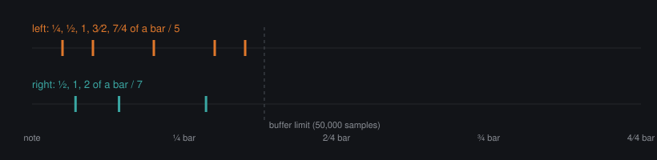

<sub>Tap lengths as fractions of the bar: left (orange) on fifths, right (teal) on sevenths. A note played on the downbeat comes back on these marks, and again from the feedback.</sub>

## 11. A reverb that fills the gaps

> **`directed`** A reverb that swells to fill in where the voices are sparse was Joshua's. **`Claude`** The FDN design and its mapping are Claude's.

The reverb is an eight-line **feedback delay network** (FDN). The lines are mutually prime lengths, 2011 to 4507 samples, so their echoes never pile up on the same sample. They are mixed through an orthogonal **Hadamard matrix** (energy-preserving, every line feeding every other) behind four all-pass diffusers per side. Each line's gain is set so that the tail decays by 60 dB in RT60 seconds:

> <i>g<sub>i</sub></i> = 10<sup>−3 <i>L<sub>i</sub></i> / (RT<sub>60</sub> · <i>f<sub>s</sub></i>)</sup>, <i>H</i><sub>8</sub> = <i>H</i><sub>2</sub> ⊗ <i>H</i><sub>2</sub> ⊗ <i>H</i><sub>2</sub>, <i>H</i><sub>2</sub> = [[1, 1], [1, −1]] / √2

`reverb.c:75`

```c
/* the network */
for (i = 0; i < RV_LINES; i++)
{
    float d = r->line[i][r->pos[i]];
    float g = powf (10.0f, -3.0f * r->len[i] / (r->rt60 * FS));
    r->lp[i] += (d - r->lp[i]) * lpk;
    y[i] = r->lp[i] * g;
    if (i % 2) o_r += (i & 2 ? -1.0f : 1.0f) * d;
    else       o_l += (i & 4 ? -1.0f : 1.0f) * d;
}
/* Hadamard mixing (in place, normalised) */
for (i = 0; i < RV_LINES; i++) x[i] = y[i];
for (h = 1; h < RV_LINES; h <<= 1)
    for (i = 0; i < RV_LINES; i += 2 * h)
    {
        int j;
        for (j = i; j < i + h; j++) { float p = x[j], q = x[j + h]; x[j] = p + q; x[j + h] = p - q; }
    }
for (i = 0; i < RV_LINES; i++)
{
    r->line[i][r->pos[i]] = x[i] * 0.35355339f + ((i % 2) ? in_r : in_l);
    if (++r->pos[i] >= r->len[i]) r->pos[i] = 0;
}
```

What makes this reverb particular is what drives it. It follows how full past is: the sum of the sixteen voice envelopes, smoothed, rising fast (0.8 s) and falling slowly (2.5 s). When past thins out, the reverb **swells**: the wet level rises from 0.06 to 0.70 and the tail lengthens from 2.2 s to 7.5 s. The space fills in exactly where the notes leave it.

`reverb.c:60`

```c
/* how full past is: follow the envelope sum, slowly when it thins */
a = env_sum > r->density ? 1.0f / (RISE_S * FS) : 1.0f / (FALL_S * FS);
r->density += (env_sum - r->density) * a;
sp = 1.0f - smoothstep (0.4f, 6.0f, r->density);
r->sparse = sp;
r->wet = WET_MIN + (WET_MAX - WET_MIN) * sp;
r->rt60 = RT_MIN + (RT_MAX - RT_MIN) * sp;
```

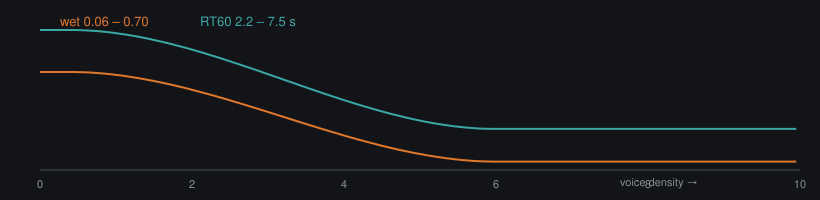

<sub>Wet level (orange) and RT60 (teal) against voice density, the sum of the envelopes: a smoothstep from 0.4 to 6.</sub>

## 12. Long swells and endlessness

> **`directed`** Running the mathematics on endlessly, and dialling the choir and bass up and down on coprime 5- and 9-minute sines, were Joshua's. **`Claude`** What each swell changes (ranks, width, drive, cutoff) is Claude's.

past was written to last about eight minutes; its sections are counted in minutes and seconds. In endless mode the section clock wraps every 8 minutes, the tick period has a floor, and notes are folded back into range, so the mathematics runs on indefinitely. Above that sit slow controls whose periods are chosen to be coprime, so their combinations take a long time to repeat:

| control | period | low | high |
|---|---|---|---|
| choir richness | 5 min | narrowing toward mono, 0.7× level | second rank an octave up, third a fifth up, full stereo, 1.3× level |
| bass weight | 9 min | 0.35×, nearly a pure sine, darker | 1.35×, more body and drive, brighter |
| voice arc | 150 s × 330 s | 2 voices | 16 voices |
| past's sections | 8 min | which of past's figures play (the choir sings in minutes 1–3 of each 8) |  |
| rhythm genes | ~7 min, random | one coprime division changes |  |

Periods of 5 and 9 minutes realign only after lcm(5, 9) = 45 minutes; together with the 8-minute sections, after lcm(5, 8, 9) = 360 minutes. The random mutations break even that.

`past_engine.c:734`

```c
s->choir_rich = (float) (0.5 - 0.5 * cos (2.0 * PI * t / 300.0));
s->bass_rich  = (float) (0.5 + 0.5 * sin (2.0 * PI * t / 540.0));
```

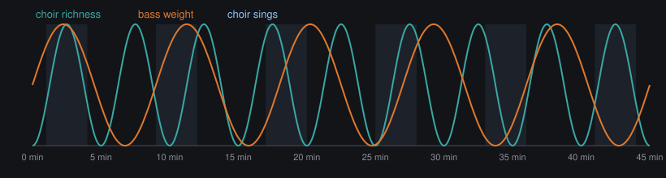

<sub>45 minutes: choir richness (teal, 5 min), bass weight (orange, 9 min), and the stretches where past's sections let the choir sing (shaded). Each return of the choir falls at a different point on both curves.</sub>

## 13. The picture

> **`original`** p10m1, 2012: the feedback, blur and matte look, the cube layout and the palette. Claude ported them to the GPU, keeping the integer arithmetic. **`directed`** More cubes on different axes tied to the music, inverse zoom (5× at no voices), and an orange lattice through the black that is driven by the score and comes back changed, were Joshua's. **`Claude`** The circle-of-fifths mapping to axes, and the lattice's specific variants and colours, are Claude's.

p10m1 is a **feedback** image. Every frame, the previous frame is blurred, and the newly rendered cubes replace it only where they are, with the old picture showing through their insides. The blur and the feedback emulate the original's integer arithmetic exactly, truncating toward zero, so small values always lose a little and the interiors sink toward black over many frames. That slow sinking is p10m1's look.

`main.c:1125`

```c
static const char *fs_feedback = GLSL_COMMON
    "uniform sampler2D tp, tc; uniform vec2 sz; uniform float im;\n"
    "void main () { vec2 p = gl_FragCoord.xy; vec4 a = I (tp, p, sz), c = I (tc, p, sz);\n"
    " vec3 d = (c.rgb - a.rgb) * im / 256.0;\n"
    " gl_FragColor = vec4 (a.rgb + vec3 (tr (d.r), tr (d.g), tr (d.b)), 255.0) / 255.0; }\n";
```

### Cubes that orbit with the notes

180 cubes are divided among the sixteen voices; each cube's size follows its voice's envelope. Each voice's group of cubes turns about an axis taken from the note it plays. The pitch class is placed on the **circle of fifths** (multiply by 7 mod 12), so related notes turn on nearby axes, and the octave tilts the axis. A semitone step reverses the direction. The orientation is a quaternion integrated every frame, so a change of note is a slowing down and turning back, never a jump.

> θ = 2π · (7·pc mod 12)/12, φ = 22° + 16°·octave, axis = (sin φ cos θ, cos φ, sin φ sin θ), <i>q</i> ← Δ<i>q</i>(axis, ω·d<i>t</i>) · <i>q</i>

`main.c:208`

```c
int   note = P.note[j], pc = ((note % 12) + 12) % 12, oc = ((note / 12) % 4 + 4) % 4;
float th = 2.0f * (float) M_PI * ((pc * 7) % 12) / 12.0f;
float ph = (float) M_PI / 180.0f * (22.0f + 16.0f * oc);
float drive = (j % 2) ? P.drive_u : P.drive_v;
float dir = (pc % 2 ? -1.0f : 1.0f) * (drive < 0 ? -1.0f : 1.0f);
ax[0] = sinf (ph) * cosf (th); ax[1] = cosf (ph); ax[2] = sinf (ph) * sinf (th);
w = dir * (7.0f + 30.0f * env);
```

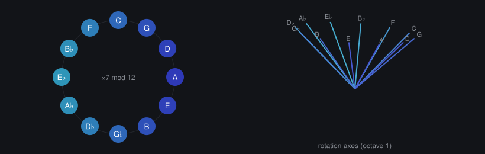

<sub>Pitch classes on the circle of fifths. Neighbours (C–G–D …) share most of their notes, and their cubes turn on neighbouring axes.</sub>

### The lattice in the black

Where the feedback has sunk to near black, an orange triangular lattice shows through. Its four layers pulse with the four polyrhythm layers, and its spacing, thickness, hue and repetition follow the score. When it fades out it comes back changed: rotated, sheared by an affine map, warped, less dense, and recoloured within an orange / teal / blue family. Repetition, then surprise.

### Zoom

The camera zooms in inversely to the number of voices sounding: about 5× when past is silent, 1× at ten or more voices. As the music thins out, the picture moves closer.

## 14. Glass

> **`directed`** Glass cubes that refract and disperse, lossy and imperfect (bumps, fractures), and the corrections to them, were Joshua's. **`Claude`** The physics and the shaders (tangent-space flaws, Snell refraction, absorption, Fresnel, dispersion) and their constants are Claude's.

About one cube in nine is glass. A separate pass renders the glass cubes' surface normals into a half-float buffer. Some glass is perfect, some gently bumped, some strongly bumped, some fractured into shards. The flaws are a tiling height field stored as slopes along the face's own two edge directions (**tangent space**). A small shader tilts each face's normal by the slope along its actual edges, so a bump bends light the way the face is really turned, whatever the cube's rotation:

> <i>n</i>′ = normalize(<i>n</i> − (∂<i>h</i>/∂<i>u</i>) <i>t</i> − (∂<i>h</i>/∂<i>v</i>) <i>b</i>)

`main.c:1136`

```c
static const char *fs_flaw = "#version 120\n"
    "uniform sampler2D flaw; uniform float amt; varying vec3 vn, vt, vb;\n"
    "void main () { vec4 f = texture2D (flaw, gl_TexCoord[0].st);\n"
    " vec2 s = (f.rg * 2.0 - 1.0) * 0.6 * amt;\n"
    " vec3 n = normalize (vn), t = normalize (vt - dot (vt, n) * n), b = normalize (vb - dot (vb, n) * n);\n"
    " n = normalize (n - s.x * t - s.y * b);\n"
    " if (n.z < 0.0) n = -n;\n"
    " gl_FragColor = vec4 (0.5 + 0.5 * n.x, 0.5 + 0.5 * n.y, mix (0.5, f.b, amt), 1.0); }\n";
```

The glass pass bends the view ray at that normal by **Snell's law** (refractive index 1.5) and looks up the picture where the bent ray lands. Each colour channel bends by a slightly different amount, which gives **dispersion**, the rainbow fringes. Light is absorbed along the path through the glass (Beer–Lambert), more in red than in blue, and grazing faces reflect more (Fresnel):

> <i>η</i><sub>1</sub> sin <i>θ</i><sub>1</sub> = <i>η</i><sub>2</sub> sin <i>θ</i><sub>2</sub>, <i>T</i> = exp(−<i>σ</i> · path), <i>σ</i> = (0.17, 0.12, 0.08) for r, g, b

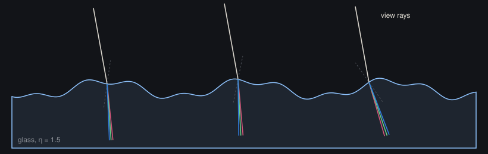

<sub>A view ray bends at the bumped surface; red, green and blue bend by slightly different amounts (the split is exaggerated here so it is visible). The choir's level sets how hard the glass bends light, and the bell sets how widely the colours spread.</sub>

`main.c:1178`

```c
/* Snell at the face (n = 1.5): the ray's bend on screen, times the glass's
   thickness there (thicker where its surface is high) */
"  vec3 t = refract (v, n, 1.0 / 1.5);\n"
"  vec2 dv = (t.xy / min (t.z, -0.45) - v.xy / v.z) * k * 3.0 * (0.6 + 0.8 * h);\n"
"  vec3 sh = vec3 (1.0 - disp, 1.0, 1.0 + disp), o;\n"
"  o.r = texture2D (src, (p + dv * sh.r) / sz).r * 255.0;\n"
"  o.g = texture2D (src, (p + dv * sh.g) / sz).g * 255.0;\n"
"  o.b = texture2D (src, (p + dv * sh.b) / sz).b * 255.0;\n"
"  float path = (0.6 + 0.8 * h) / (0.35 + 0.65 * c);\n"
```

## 15. A title that gets eaten

> **`directed`** The title, its text, D-DIN, and its being eaten by the picture were Joshua's. **`Claude`** The integrity mechanism is Claude's.

The title, PAST / HARM over the credit, is set in D-DIN with CoreText into a coverage mask in the bottom left. Each text pixel has an **integrity** that can only fall. Wherever the evolving picture differs from the plain background behind the letters, they are nibbled away, raggedly, and the damage creeps inward from the bitten edges. The title is stamped in **before** the feedback, so its fragments are dragged into the blur and the echoes. Within a couple of minutes, the work has eaten its own name.

`main.c:1226`

```c
static const char *fs_integ = GLSL_COMMON
    "uniform sampler2D tprev, tf, tb; uniform vec2 box, fsz, isz; uniform float dt, rate, seed;\n"
    "float h (vec2 p, float s) { return fract (sin (dot (p, vec2 (12.9898, 78.233)) + s * 0.618) * 43758.5453); }\n"
    "void main () { vec2 p = gl_FragCoord.xy; float v = texture2D (tprev, p / isz).r;\n"
    " if (v > 0.0) { vec2 f = box + p; vec3 a = I (tf, f, fsz).rgb, b = I (tb, f, fsz).rgb;\n"
    "  float d = (abs (a.r - b.r) + abs (a.g - b.g) + abs (a.b - b.b)) / 3.0, act = clamp ((d - 18.0) / 70.0, 0.0, 1.0);\n"
    "  if (act > 0.0) v -= dt * rate * act * (0.4 + 1.6 * h (p, seed));\n"
    "  float m = (texture2D (tprev, (p + vec2 (-1, 0)) / isz).r + texture2D (tprev, (p + vec2 (1, 0)) / isz).r\n"
    "           + texture2D (tprev, (p + vec2 (0, -1)) / isz).r + texture2D (tprev, (p + vec2 (0, 1)) / isz).r) * 0.25;\n"
    "  if (m < v) v -= dt * 0.5 * (v - m) * (0.5 + h (p + 17.0, seed));\n"
    "  v = max (v, 0.0); }\n"
    " gl_FragColor = vec4 (v); }\n";
```

## 16. Who made what

This version was made in November 2026 by Joshua Reich working with Claude, Anthropic's AI model. He set the direction and the constraints, chose the techniques in many places, and judged every result. Claude wrote most of the new code and made many of the detailed choices. Counting code lines only (comments and lone braces excluded, renamed variables matched), about 260 of the roughly 2,800 lines are carried over verbatim from the original programs:

| file | from | kept from the original |
|---|---|---|
| `past_engine.c` | past.c (pre-2003) | 20% of the file's lines. Kept: past's whole main loop (voices, scale tables, timing, the cross-coupled filter). Dropped: its sound-card and file set-up. |
| `harm_fx.c` | harm3.c (pre-2003) | 36%. Kept: `convolve()`, the networks, the chaotic counters and the clicks. |
| `main.c` | p10m1 (2012) | 5%. The GPU port rewrote the drawing; kept are the cube layout and the blur / matte / feedback behaviour, re-expressed as shaders. |
| everything else | — | New: audio output, reverb, key finding, title, tools. |

Line counts alone mislead. Most of the piece's character comes from the original systems: past's composition and synthesis, harm's networks and p10m1's feedback picture. Every 2026 addition started from Joshua's request, and those requests often named the technique (Gaussian bands with random phases, coprime seeds, 5- and 9-minute sines, the lattice in the black, the eaten title). The **`Claude`** labels mark where the specific choices were Claude's, among them the drum sounds, the harmony method, the reverb, the glass physics and many constants. Those are a large part of what is heard and seen, and they are credited here as such.

Generated from the source of p10m1-past (written with Claude). Every code block above is copied verbatim from the file and line shown, and the diagrams are drawn from the same formulas the code uses.
